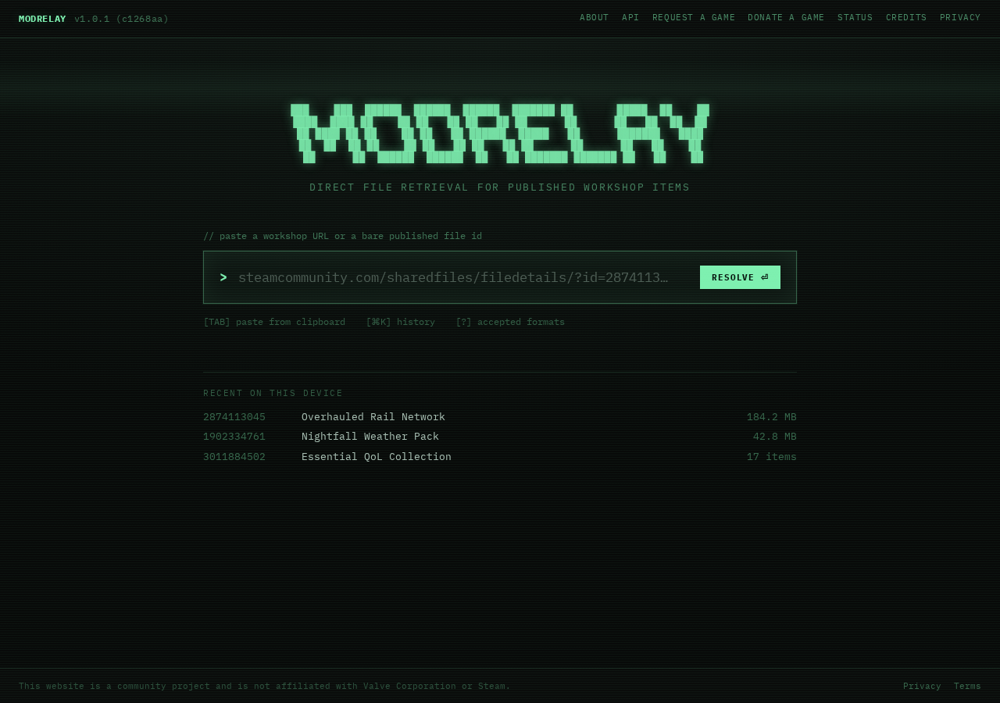
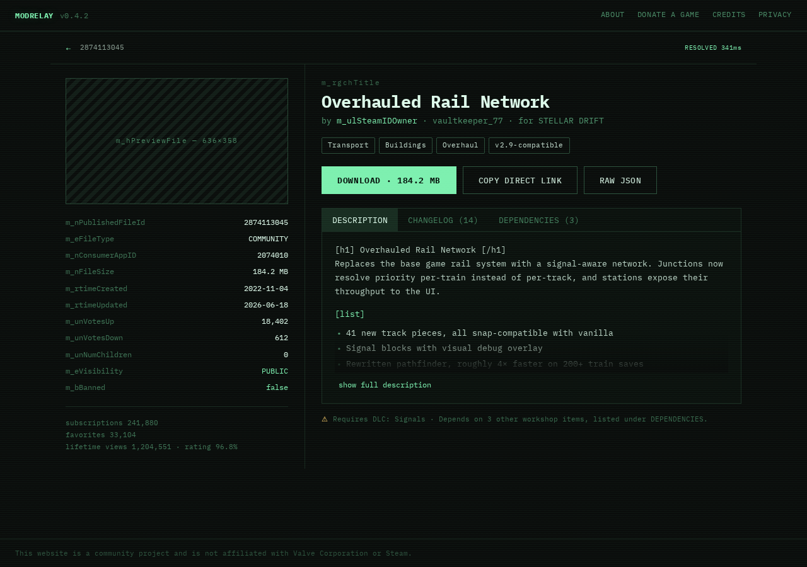
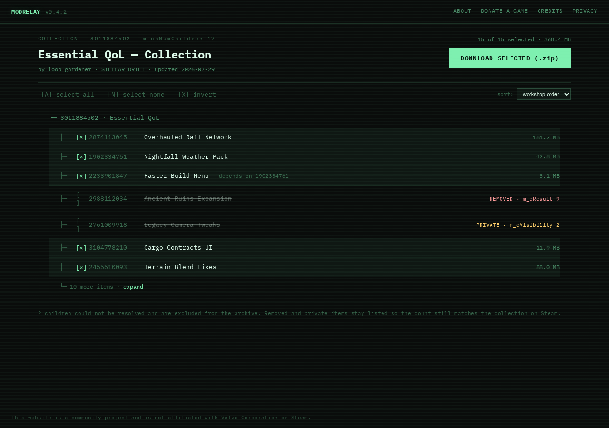
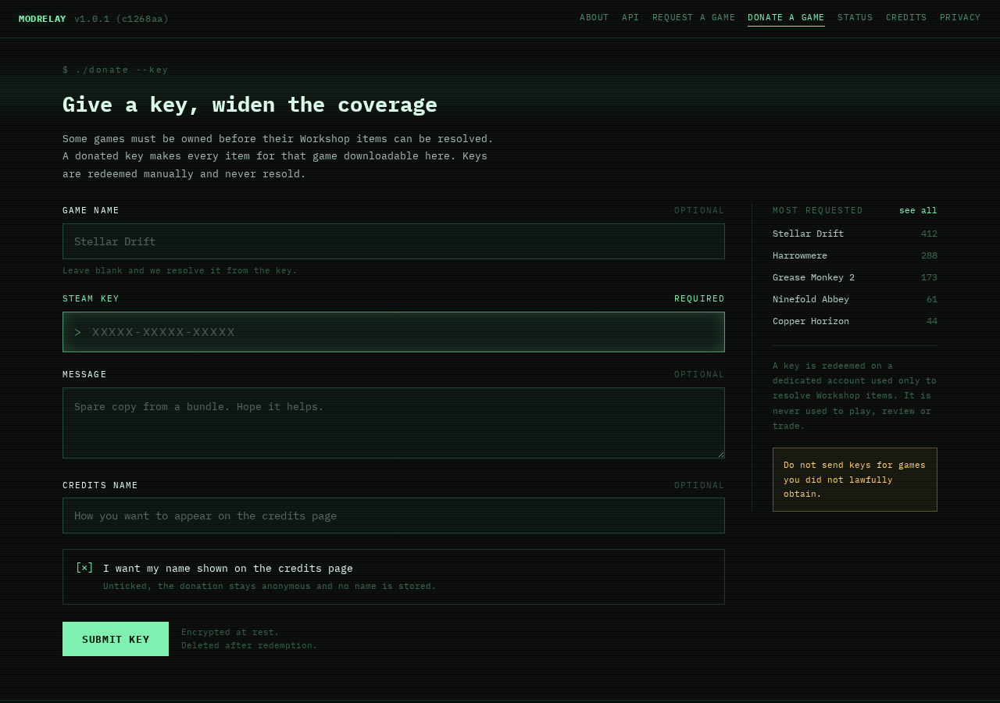
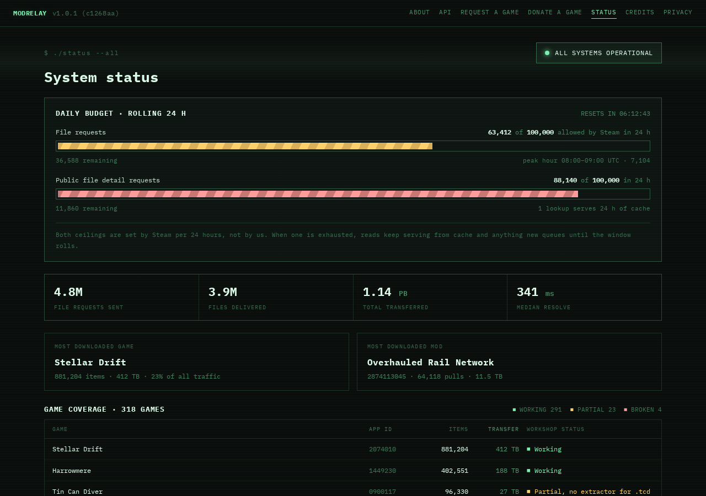
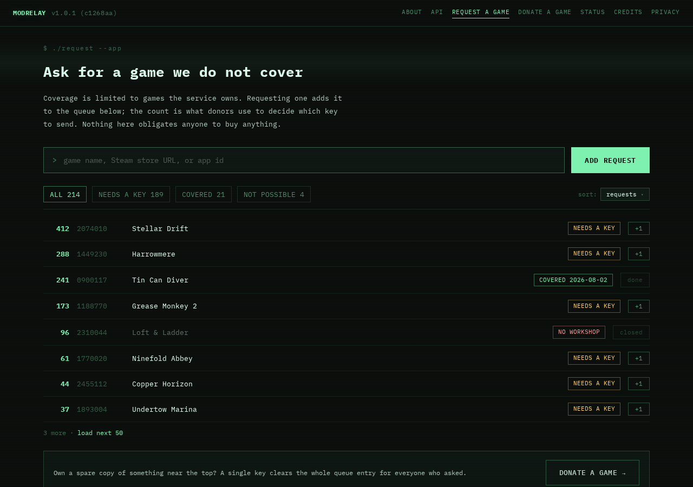
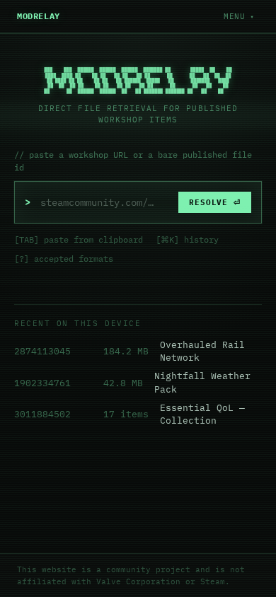

# MODRELAY

Direct file retrieval for published Steam Workshop items — paste a Workshop URL or a bare item ID and download it, no Steam client required.

Lives at [modrelay.lonewolves.dev](https://modrelay.lonewolves.dev).


This website is a community project and is not affiliated with Valve Corporation or Steam.

## Preview

| | |
|---|---|
|  |  |
|  |  |
|  |  |



## Features

- **Lookup** — paste a `sharedfiles`/`workshop` filedetails URL or a bare published file ID; parses, resolves, and remembers recent lookups on-device (`localStorage`, nothing sent anywhere)
- **Item detail** — every UGC field (`m_rgchTitle`, `m_nFileSize`, `m_unVotesUp`, …), tags, description, changelog, and dependencies, dry and technical rather than marketing gloss
- **Collections** — rendered as a tree (a collection is literally a parent node with children); per-item selection, select all/none/invert, sort, and a live selected-size total for the archive download
- **Download** — an animated transfer modal with a live log stream and progress bar
- **Donate a game** — accept a Steam key to widen coverage for games that gate Workshop access behind ownership
- **Request a game** — vote for games not yet covered; the count is what donors use to pick which key to send
- **Public API + apply flow** — documented endpoints for third-party use, gated behind a hand-reviewed key application
- **System status** — live daily-quota usage, throughput totals, and per-game Workshop coverage
- **Sitewide quota banner** — a three-state (approaching/exhausted/recovering) strip that gates the download buttons on item/collection pages when the (mocked) daily Steam request budget runs out, with a client-side "queue for later"
- **Credits** — donor names colored by a deterministic FNV-1a hash of the name, so a given name always renders the same hue
- Full error states (bad input, removed item, private item, rate limited, 404), and a responsive layout down to phone widths

## Status

The **frontend is complete** and runs entirely against mock data in [`src/data/items.ts`](src/data/items.ts) — there's no real Steam integration yet. The **backend is a minimal scaffold**: a Go service with a health check and a Redis-backed counter to prove the container wiring, plus a `501 Not Implemented` placeholder where Workshop resolution goes. The plan is to build that out with [`go-steamcmd`](https://github.com/frantjc/go-steamcmd).

## Tech stack

- **Frontend** — [Preact](https://preactjs.com/) + [Vite](https://vitejs.dev/) + TypeScript, no router/state library (see [`src/router.tsx`](src/router.tsx) — a ~90-line dependency-free router)
- **Backend** — Go, [go-redis](https://github.com/redis/go-redis)
- **Infra** — nginx (static assets + reverse proxy to the API), Redis (lookup/API caching), Docker Compose, GitHub Actions

## Getting started

Frontend only, against the mock data:

```sh
npm install
npm run dev
```

Full stack (nginx + backend + Redis) via Docker Compose:

```sh
docker compose up --build
```

The site is then at `http://localhost:8080` (see `HTTP_PORT` in [`.env.example`](.env.example)). `nginx` serves the built frontend and reverse-proxies `/api/*` to the Go backend; the backend talks to `redis` over the compose network.

## Project structure

```
src/                  Preact frontend
  pages/               route-level components
  components/          shared UI (header, footer, download modal, ...)
  data/items.ts         mock items/collections/donors — the seam to replace
                         with real API calls once the backend exists
  hooks/useSEO.ts       per-route title/description/canonical/OG tags
  router.tsx            the whole client-side router

backend/               Go API scaffold
  main.go                healthz, redis-backed stats, placeholder resolve route

nginx.conf             static file serving + /api/ reverse proxy
docker-compose.yml     nginx + backend + redis
.github/workflows/     ci.yml (build checks) + release.yml (see below)
```

## Releases

Versioning is the **7-character short commit hash**, not semver — there's no manual tagging step. On every push to `main`, [`release.yml`](.github/workflows/release.yml):

1. builds the `nginx` and `backend` Docker images, tagged with the short hash
2. `docker save`s both to `.tar.gz`, alongside `docker-compose.yml`/`.env.example` and a checksums file
3. publishes all of it to a **GitHub Release** — deliberately not GHCR or any other registry

To deploy a given release:

```sh
VERSION=<short-hash>
gunzip -c nginx-$VERSION.tar.gz | docker load
gunzip -c backend-$VERSION.tar.gz | docker load
VERSION=$VERSION docker compose up -d
```

## SEO

The site is a client-rendered SPA with no server-side rendering, which caps how much on-page SEO can do — there's no HTML per-route for crawlers that don't execute JavaScript. What's here:

- [`src/hooks/useSEO.ts`](src/hooks/useSEO.ts) sets `document.title`, the meta description, canonical link, and OpenGraph/Twitter tags on every route change, for crawlers that do run JS (Googlebot does)
- `index.html` carries static OpenGraph/Twitter/JSON-LD tags as the fallback every non-JS link unfurler (Discord, iMessage, Slack, …) sees, regardless of which page was actually shared
- [`public/robots.txt`](public/robots.txt) and [`public/sitemap.xml`](public/sitemap.xml) cover the static routes (`/`, `/about`, `/donate`, `/credits`, `/privacy`, `/request`, `/api`, `/api/apply`, `/status`); item/collection pages are excluded since they're mock data for now — once the backend is real, those should come from a generated sitemap instead of a hand-written one
- `public/og-image.png` is a real screenshot of the lookup page at 1200×630

`https://workshop.lonewolves.dev` is the single source of truth for the domain, set in [`src/lib/seo.ts`](src/lib/seo.ts) and mirrored statically in `index.html`, `robots.txt`, and `sitemap.xml`.
